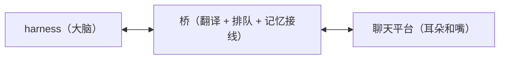

# 愿景与范围

> 状态：草稿，等用户过目。
> 来源标注：**用户裁定** = 用户原话或明确确认过的决定；**实现默认** = 实现者的工程判断，可以随时推翻，不需要用户同意。

## 一句话愿景

来源：用户裁定

把各种 **agent harness**（DSH、WorkBuddy、Trae、Codex、OpenClaw……）接进各种**聊天平台**（QQ、KOOK、Discord、Telegram……），让用户在群里、私聊里直接和自己的 agent 对话。

**这不是一个「QQ 机器人框架」。** QQ 只是第一个平台，OneBot 只是第一个协议实现。凡是只在某个平台或某个 harness 上成立的东西，都不进核心。

## 三个角色

- **harness**：真正思考的东西。它有自己的工具（读文件、跑命令、搜索），桥一概不碰。
- **桥**：本项目。它做四件事——把平台消息翻译成 agent 能读的形态、决定什么时候叫醒会话、把对话记录和长期记忆接好线、把 agent 的回复送回正确的房间。
- **平台**：消息从哪来、回哪去。每个平台的具体语义由各自的适配器消化。

## 核心管什么

来源：用户裁定（对话 2026-10-25 对齐），个别条目标实现默认

1. **房间与订阅模型**：会话 = 订阅一组房间的 agent 实体（ADR-0017）；每条订阅 = 一个连接 + 一个房间 + 唤醒策略（发送用哪把账号由连接决定，订阅不再重复写）。唤醒策略有默认实现，且**可被用户替换成自己的逻辑**（来源：用户裁定）。
2. **策略机制**：策略是可插拔的行为逻辑（默认实现内置于核心，用户可换成内嵌脚本或外置进程）。订阅的三条配置都是策略（来源：用户裁定）。
3. **唤醒判定**：按订阅条目的唤醒策略决定「什么时候为会话开一轮」。默认唤醒策略：@ 我就醒 + 叫昵称就醒 + 攒够 N 条就醒（来源：用户裁定）。
4. **未读、水位、流水**：每个房间各自累积未读、各自记水位；完整消息流水永久保存。开轮次时只投递触发那一轮的房间的未读（用户裁定：选项二）。
5. **消息内容模型**：跨平台中立的标准内容元素表（text / at / quote / image / audio / video / file / 表情），适配器对每个标准元素做最大程度适配，不支持时降级或明确报错，绝不悄悄丢弃；平台特有内容以不透明载荷原样透传。参考 Koishi 的 element 体系与 NoneBot 的 MessageSegment，不照搬 OneBot 的消息链概念（来源：用户裁定，具体元素表待架构文档定稿）。
6. **工具面**：不止发送，还要有读取（来源：用户裁定）。发送类：`send_message`（回当前轮次的房间）、`send_message_to`（`to` 受订阅范围限制）。读取类提案：`get_history`、`list_rooms`、`get_notes`、`set_note`、`del_note`、`get_platform_events`——第一版范围待用户圈定。发送类工具参数形状一致。
7. **串行轮次**：一个会话同一时刻只跑一轮，像人一样一次处理一件事（串行键 = harness 名 + 会话 id，ADR-0017）。记忆独立成仓库，一个会话可引用多份、多份记忆也可被多个会话引用——但记忆不是锁，并发按会话走。
8. **平台事件承载**：房间里的非消息事情（拍一拍、成员变动、频道创建）解成通用形状记录进流水；默认记录，但只对会话订阅的房间记（来源：用户裁定）。核心不解释事件内容。

## 核心不管什么

来源：用户裁定

1. **agent 的实现**。桥不思考，只接线。接哪个 harness、harness 用什么模型，是配置问题。
2. **harness 自己的工具**。读文件、跑命令、搜索——不归桥管。
3. **平台特有语义**。KOOK 的「频道被创建」是什么意思、QQ 的禁言怎么发——适配器负责编解码，核心只负责承载（不丢）和搬运。

## 非目标

来源：用户裁定

1. 不做自由转发：`send_message_to` 的可选目标被订阅范围封死，没有「发给任何房间」的能力。
2. 不给 harness 实时推送平台事件：事件走流水，agent 最多晚一回合看到。
3. 不在核心里实现任何平台的消息发送细节——那是适配器的活。
4. 配置修改不进 agent 工具面：agent 不能改自己的权限边界。配置由人通过 Web 管理页修改（来源：用户裁定）。

## 与旧实现的关系

旧 Rust 实现（acb-core 分支，327 个测试）与新 Node 实现都只作参考，不搬运代码。旧实现里被验证过的机制（传输抽象、钩子宿主、回合票、按记忆名串行）在新设计里以文档先行的形式重新设计。

## 待决问题

1. **唤醒策略的其它条件**：默认策略只有 @ / 昵称 / 攒 N 条（用户裁定）。关键词触发、免打扰名单、睡眠时段、概率唤醒这些，是做成默认策略的可选开关，还是不做进默认、完全交给用户自定义策略？
2. **读取类工具第一版范围**：`get_history` / `list_rooms` / `get_notes` / `set_note` / `del_note` / `get_platform_events` 里，哪些进第一版？
3. **标准元素表定稿**：8 个标准元素够不够？要不要加 markdown 之类的富文本元素？
