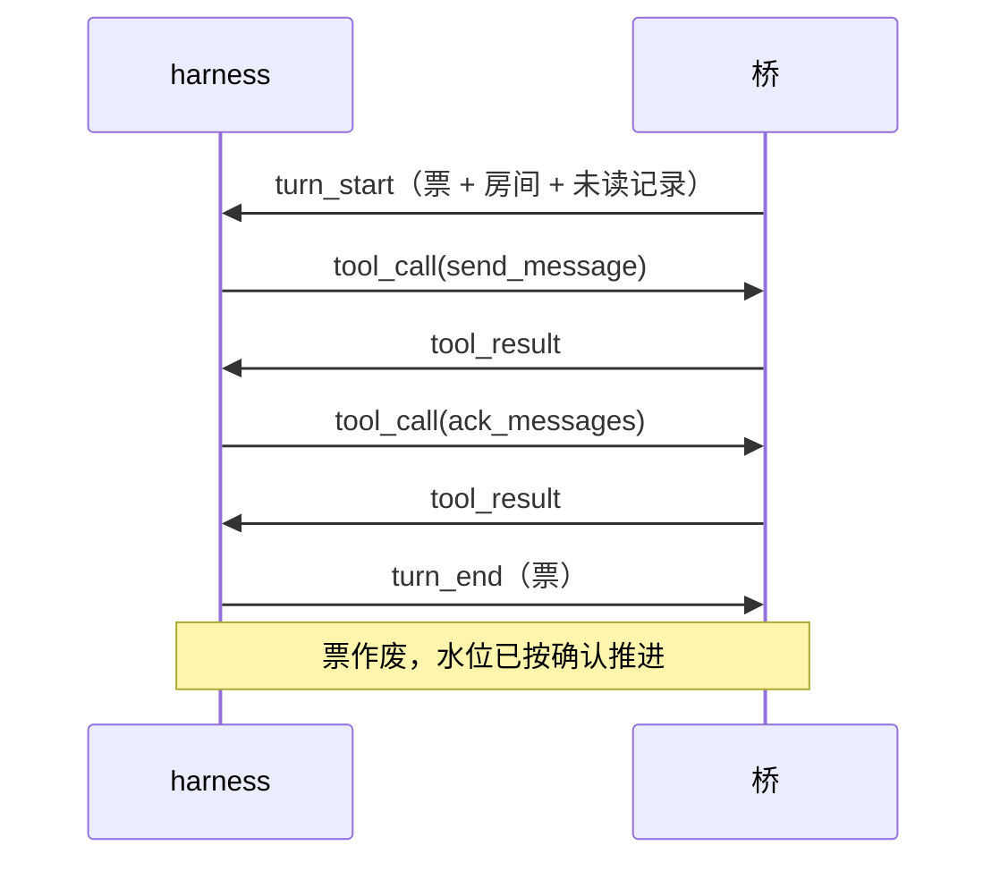

# 协议：桥 ↔ harness

> 状态：草稿，与 `crates/proto` 同步维护。
> 原则：桥不关心 harness 内部；harness 也不关心平台细节。这一层只说「投递什么、调用什么、返回什么」。

## 传输

- 一条长连接（本机套接字或 TCP），**每帧一行 JSON**，UTF-8。
- 单帧上限 1 MiB，超了直接断连。
- 首帧必须是 `hello`，带协议版本与令牌（TCP 时必填）。版本不符由桥拒绝并说明原因。

## 接入点

- 监听地址来自配置的 `[endpoint] listen`，默认只听 `127.0.0.1`，外网连不上。
- **令牌绑一组会话**：配置里几个会话写同一个 `token`，它们就是一组，由这条连接代表。令牌对不上任何会话就直接断开，不回 `ready`。
- 一条连接只服务它那一组会话：`poll_turn` 只领这组里的活，不会把别人的轮次领走。
- **跨会话发送已砍**（ADR-0017）：`send_message_to` 默认只能发到本会话订阅的房间，越界拒绝；会话的访问策略（`[sessions.access]`，ADR-0026）可以放宽这个边界。参数里没有「别的会话 id」这种入口。
- 握手 10 秒内不说话就断；空闲时桥每 100ms 回头看一眼有没有活，所以有活时最迟约 0.1 秒推过去。
- **断线不丢消息**：连接断在轮次中间，这一轮直接放掉，不确认任何消息——它们还是未读，下一轮重投（[ADR-0010](../adr/0010-ack-watermark.md)）。
- 同一组会话开两条连接不会破坏串行：桥保证一个会话同时只有一轮，第二条连接暂时领不到活。

## 帧一览

| 帧 | 方向 | 用途 |
|----|------|------|
| `hello` | harness → 桥 | 握手：协议版本 + 接入令牌 |
| `ready` | 桥 → harness | 握手成功：`sessions` = 这条连接代表哪几个会话（配置顺序）+ `maps` = 已落盘的会话映射（harness 重启后据此复用旧会话，ADR-0018） |
| `turn_start` | 桥 → harness | 开一轮：回合票 + 会话 + 记忆 + 房间 + 本次投递的记录 + 开轮原因 + 轮次超时 |
| `turn_end` | harness → 桥 | 本轮收工（可带错误） |
| `tool_call` | harness → 桥 | 调用**桥的工具面**（ADR-0006：发送/读取/笔记这些 acb 内置工具）：票 + 工具名 + 参数。harness 自己挂的工具（如 dsh 的 MCP）不经桥 |
| `tool_result` | 桥 → harness | 工具结果或错误 |
| `control` | 桥 → harness | 控制指令（如重置会话映射）。桥只转发，语义由 harness 决定（ADR-0018） |
| `control_result` | harness → 桥 | 控制指令的执行结果 |
| `log` | 桥 → harness | 给 harness 侧的日志，不影响流程 |
| `ping` / `pong` | 双向 | 保活 |

## 一轮的形状



要点：

- **票是唯一身份**。`tool_call` 必须带本轮的票，票在 `turn_start` 签发、`turn_end` 作废。票不对，调用一律拒绝。
- 一轮只投一个房间的记录（[ADR-0003](../adr/0003-serial-turns.md)）。
- 同一会话的轮次串行（串行键 = harness 名 + 会话 id，ADR-0017）：上一轮 `turn_end` 之前不会有下一轮 `turn_start`。不同会话各自并发，记忆不是锁。

## 一次投递（delivery）

`turn_start` 上带的 `delivery`：

| 字段 | 含义 |
|------|------|
| `ticket` | 本轮的票。之后每个 `tool_call` 都要带上它 |
| `session` | 这一轮替哪个会话干活 |
| `memories` | 会话引用的记忆列表（id + worktree 路径，惰性 checkout，ADR-0017）。记忆独立成仓库，一个会话可引用多份 |
| `session_info` | 会话身份：id / name / harness / model（model 为空 = harness 侧自己决定） |
| `persona` | 人格卡 `{id, name, text}`。桥只给语义，怎么塞进模型上下文由 harness 适配器决定 |
| `room` | 本轮只涉及这一个房间 |
| `records` | 投递的记录，可能为空 |
| `more` | 非 0 表示投递超限、有 N 条未读没投进来。数值等于 `omitted.count` |
| `omitted` | 被跳过的未读区间：`{from, to, count}`。桥按「最旧一小段 + 最新一批」投递，中间这段跳过；需要时用 `get_history({after, before})` 或 `fetch_records` 回看 |
| `reason` | 为什么开这一轮：`wake` / `clock` |
| `turn_timeout_ms` | 本轮超时（毫秒），来自配置 `turn_timeout_secs`；0 = 关闭超时。到点 harness 应主动打断这轮（如 dsh 的 session/cancel），打断按失败处理走 `on_turn_error` |

## 记录（record）

投递给 harness 的最小单位是「记录」，消息与平台事件统一用这个形状：
```json
{
  "id": 42,
  "room": {"connection": "qq", "path": ["group", "123456"]},
  "kind": {"kind": "message"},
  "sender": {"id": "10001", "name": "老王"},
  "at": 1793000000000,
  "elements": [{"type": "text", "text": "在吗"}],
  "at_self": false,
  "reply_to_self": false,
  "platform_id": "592852179",
  "redelivery": null
}
```

- `room`：连接名 + 路径段。路径由适配器决定怎么切（QQ 是 `group/123`、`private/456`；
  Discord 这类会更深，如 `guild/9/channel/7/post/8`）。核心不认识段里的词，只把它当一串段
  ——所以要前缀查「这个群下面所有楼」也是免费的（[ADR-0012](../adr/0012-platform-connections.md)）。
- `id`：房间内递增编号，水位按它推进。
- `kind`：`message`，或 `{"kind":"event","event":"poke","tags":["poke","notice"],"payload":{…},"summary":"[拍了拍我]"}`；拍一拍就是 `event: poke`（[ADR-0007](../adr/0007-poke-as-message.md)）。事件记录现在带跨平台语义标签 `tags`、原始载荷 `payload` 和一句人话 `summary`；`summary` 是说明，不是对方说的话。
- `at_self`：这条是不是冲本账号来的（@ 到我、拍我）。
- `reply_to_self`：这条是不是**引用了我发的某条消息**。
  `at_self` 和 `reply_to_self` 是两个事实，不是一个：@ 是明确点名，引用是接着某句话往下说。
  默认两者都会叫醒（`wake.at_mention` / `wake.reply`），但可以分别关掉。
  判定靠反查：被引用那条如果是本房间的发送账号发的，就算数；查不到（被清理了、对面没给编号）
  就当不是——宁可少叫醒一次，也不凭编号长相猜。
- `platform_id`：平台自己的消息编号（QQ 的 `message_id`）。留着只有一个用途：别人引用某条时，
  靠它反查「被引用的是谁发的」。我方发出去的消息也带，所以「引用了我」才判得出来。
- `redelivery`：非空表示「第 N 次投递」。
- `note`：桥附在**这次投递**上的旁白，不是发送者说的话。目前只在重投时出现，内容是
  「第 2 次投递；调 ack_messages 确认 #5 之后就不再重复投递」。

  为什么要由桥来写这句：它是**行为要求**（agent 得知道怎么让重复投递停下），不是某家
  harness 的排版偏好。放在桥里，接新 harness 不用重新发明一遍（[ADR-0010](../adr/0010-ack-watermark.md)）。

  为什么单独一个字段、不塞进 `elements`：`elements` 是对方说的话。旁白混进内容，人和模型
  都会以为「对方打了这行字」——真机上已经出现过一次。harness 的呈现义务是：**内容照原样，
  旁白另起一行**，两者不能拼在一起。

  旁白只出现在投给 harness 的副本上，流水里存的是原话。

## 内容元素

| 元素 | 字段 |
|------|------|
| `text` | `text` |
| `at` | `target`，`all`（是否 @ 全体） |
| `quote` | `message_id` |
| `image` | `url`，可选 `alt` |
| `audio` / `video` | `url` |
| `file` | `url`，`name` |
| `face` | `platform`，`id` |
| `opaque` | `platform`，`payload`（平台特有内容原样透传，核心不解释） |

元素表只增不改；加元素是兼容演进（[ADR-0004](../adr/0004-content-elements.md)）。

## 错误码

`bad_request`、`unauthorized`、`tool_not_allowed`、`room_not_subscribed`、`timeout`、`internal`。

工具失败一律用 `tool_result.error` 返回，不拆连接——只有协议本身坏了才断。
