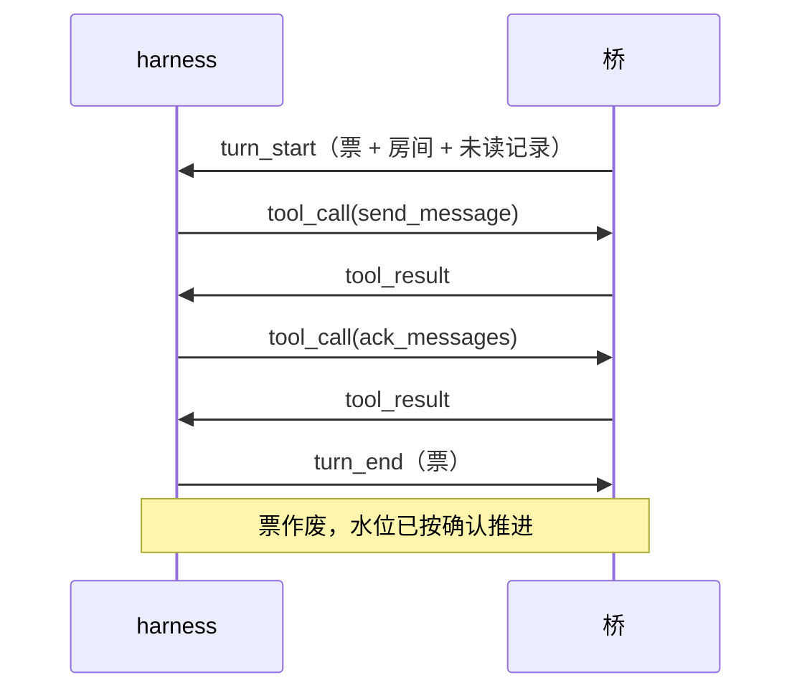

# 协议：桥 ↔ harness

> 状态：草稿，与 `crates/proto` 同步维护。
> 原则：桥不关心 harness 内部；harness 也不关心平台细节。这一层只说「投递什么、调用什么、返回什么」。

## 传输

- 一条长连接（本机套接字或 TCP），**每帧一行 JSON**，UTF-8。
- 单帧上限 1 MiB，超了直接断连。
- 首帧必须是 `hello`，带协议版本与令牌（TCP 时必填）。版本不符由桥拒绝并说明原因。

## 接入点

- 监听地址来自配置的 `[endpoint] listen`，默认只听 `127.0.0.1`，外网连不上。
- **令牌绑设备**：每个设备在配置里有自己的 `token`，握手时令牌对上哪个设备，这条连接就绑到哪个设备。令牌不对直接断开，不回 `ready`。
- 一条连接只服务一个设备：`poll_turn` 只领本设备的活，不会把别人的轮次领走。
- 握手 10 秒内不说话就断；空闲时桥每 100ms 回头看一眼有没有活，所以有活时最迟约 0.1 秒推过去。
- **断线不丢消息**：连接断在轮次中间，这一轮直接放掉，不确认任何消息——它们还是未读，下一轮重投（[ADR-0010](../adr/0010-ack-watermark.md)）。
- 同一设备开两条连接不会破坏串行：桥保证一个设备同时只有一轮，第二条连接暂时领不到活。

## 帧一览

| 帧 | 方向 | 用途 |
|----|------|------|
| `hello` | harness → 桥 | 握手：协议版本 + 接入令牌 |
| `ready` | 桥 → harness | 握手成功：告诉 harness 绑定的设备 |
| `turn_start` | 桥 → harness | 开一轮：回合票 + 房间 + 本次投递的记录 + 开轮原因 |
| `turn_end` | harness → 桥 | 本轮收工（可带错误） |
| `tool_call` | harness → 桥 | 调用工具：票 + 工具名 + 参数 |
| `tool_result` | 桥 → harness | 工具结果或错误 |
| `log` | 桥 → harness | 给 harness 侧的日志，不影响流程 |
| `ping` / `pong` | 双向 | 保活 |

## 一轮的形状



要点：

- **票是唯一身份**。`tool_call` 必须带本轮的票，票在 `turn_start` 签发、`turn_end` 作废。票不对，调用一律拒绝。
- 一轮只投一个房间的记录（[ADR-0003](../adr/0003-serial-turns.md)）。
- 同一设备的轮次串行：上一轮 `turn_end` 之前不会有下一轮 `turn_start`。

## 记录（record）

投递给 harness 的最小单位是「记录」，消息与平台事件统一用这个形状：

```json
{
  "id": 42,
  "room": {"platform": "qq", "room": "123456"},
  "kind": {"kind": "message"},
  "sender": {"id": "10001", "name": "老王"},
  "at": 1793000000000,
  "elements": [{"type": "text", "text": "在吗"}],
  "at_self": false,
  "redelivery": null
}
```

- `id`：房间内递增编号，水位按它推进。
- `kind`：`message` 或 `{"kind":"event","event":"poke"}`；拍一拍就是 `event: poke`（[ADR-0007](../adr/0007-poke-as-message.md)）。
- `at_self`：这条是不是冲本账号来的（@ 到我、拍我）。
- `redelivery`：非空表示「第 N 次投递」。**桥同时会在这条记录的元素末尾追加一段文本**，
  写明是第几次、确认哪个编号就不再重投（如「第 2 次投递；调 ack_messages 确认 #12 之后
  就不再重复投递」）。追加只发生在投给 harness 的副本上，流水里的原文不变。

  为什么由桥来做：这句话是**行为要求**，不是某一家 harness 的排版偏好。放在桥里，
  每接一个新 harness 都不用重新发明一遍；放在 harness 里，迟早有人漏（[ADR-0010](../adr/0010-ack-watermark.md)）。

## 内容元素

| 元素 | 字段 |
|------|------|
| `text` | `text` |
| `at` | `target`，`all`（是否 @ 全体） |
| `quote` | `message_id` |
| `image` | `url`，可选 `alt` |
| `audio` / `video` | `url` |
| `file` | `url`，`name` |
| `face` | `platform`，`id` |
| `opaque` | `platform`，`payload`（平台特有内容原样透传，核心不解释） |

元素表只增不改；加元素是兼容演进（[ADR-0004](../adr/0004-content-elements.md)）。

## 错误码

`bad_request`、`unauthorized`、`tool_not_allowed`、`room_not_subscribed`、`timeout`、`internal`。

工具失败一律用 `tool_result.error` 返回，不拆连接——只有协议本身坏了才断。
