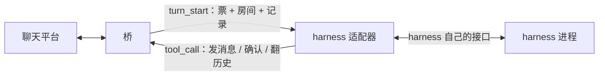

# 06 · harness 适配器

> 状态：opencode 那一份按 **v2 API** 写完了，协议层与插件逻辑都有测试；**还没在真的
> opencode 里跑完一轮**——本机 opencode2 2.0.22（Bun 1.4.2）加载任何插件都会段错误，
> 连 4 行空插件都崩。详见下面「卡在哪」。
> 原则：桥不懂 harness 的内脏，harness 也不懂平台细节。适配器是那个翻译。

## 一个适配器要干两件事

这两件事互不依赖，可以分别做到、分别缺席：

1. **工具面**：让模型看见桥上的九个工具（发消息、确认水位、翻历史、记笔记……），
   模型一调，就原样变成一帧 `tool_call` 发给桥。
2. **轮次驱动**：桥推来一轮（`turn_start`，带着这个房间的未读记录），把它变成 harness 里
   的一次对话，跑完回 `turn_end`。



只有工具面、没有轮次驱动的，叫**半接**：能发不能收，桥推过来的活没人干。这种事要在
文档里写清楚，不能让人以为接完了。

## 两半各有各的手段

| 能力 | 手段 | 需要 harness 有 | 代价 |
|------|------|-----------------|------|
| 工具面 | 插件里注册自定义工具 | 插件 / 扩展 API | 跟 harness 版本绑得紧 |
| 工具面 | 挂一个 MCP server | 支持 MCP（多数都有） | 多一层进程，桥要额外实现 MCP |
| 轮次驱动 | 进程内：插件里起后台循环，反调会话接口注入一条消息，等它回完 | 插件 API，且能反向驱动会话 | 可能和 harness 自己的事件派发打架 |
| 轮次驱动 | 进程外：桥旁边跑个小程序，用无头模式 / HTTP / CLI 驱动 | 无头模式或服务端 API | 慢；会话续接、结束判定都要自己猜 |

结论：**有插件 API 就走插件**，工具面和轮次驱动都在同一个进程里，最跟手；没有插件
API 才退到进程外驱动或 MCP。这条判断写进了 [ADR-0013](adr/0013-harness-adapter-shape.md)。

## 拿到一个新 harness，先问四句

1. 能不能注册自定义工具？（决定工具面走插件还是 MCP）
2. 能不能从扩展点里反过来驱动一次会话，并且知道它什么时候结束？（决定轮次驱动走进程内还是进程外）
3. 没有插件的话，有没有服务端 / 无头模式？能不能接着上一次的会话继续？
4. 上面都不行？那就只挂 MCP，算半接，文档里标明「只能发不能收」。

## 当前各家的情况

下面「判断」一栏里，只有 opencode 是我看过文档、写过代码的；其余是**待核实**，别当结论用。

| harness | 扩展点 | 轮次驱动 | 判断 |
|---------|--------|----------|------|
| opencode | 插件（v2：`export default { id, setup(ctx) }`；工具用 `ctx.tool.transform` 注册，模型经 `execute` 调 `tools.X`） | 进程内：`ctx.session.prompt` 排话 + `ctx.session.wait` 等它说完 | 插件型，见 `harnesses/opencode/plugin/`；真机整轮已验（私聊 + 群） |
| DSH | 插件 | 待核实 | 用户说可以走插件，具体接口未看 |
| WorkBuddy | 待核实 | 待核实 | 未看 |
| Trae | 待核实 | 待核实 | 未看 |
| Codex | 无插件；有 `codex exec` 这类无头入口 | 进程外：每轮起一次 | 大概率进程外 + MCP 补工具面 |
| OpenClaw | 待核实 | 待核实 | 未看 |

## opencode 这一份怎么用

opencode 有 v1 和 v2 两套插件 API，**写法不通用**。我们按 v2 写（本机能装到的是 v2）。

v2 的插件是一个目录：`index.js` 是入口，`acb-wire.mjs` 是协议客户端（入口 import 它）。

**不拷贝，直接指向本仓库的这个目录。** 本机根目录是 tmpfs，只有仓库是可靠的持久位置；
拷到 `~/.config/opencode/plugins/` 的东西哪天就没了。配置文件里写绝对路径即可：

```jsonc
// 全局 ~/.config/opencode/opencode.json，或某个项目根的 opencode.jsonc
{
  "plugins": [
    {
      "package": "/path/to/agent-chat-bridge/harnesses/opencode/plugin",
      "options": { "token": "设备令牌" }
    }
  ]
}
```

完整可抄的版本在 [`harnesses/opencode/opencode.jsonc.example`](../harnesses/opencode/opencode.jsonc.example)。

也可以用环境变量，选项优先于环境变量：

```bash
export ACB_TOKEN=<设备令牌>         # 和 config.toml 里设备的 token 一致
export ACB_ENDPOINT=127.0.0.1:7700  # 可选，默认就是这个
```

没给令牌时插件直接不启用，只写一条警告——不阻塞 opencode 启动。

**要用 `--standalone` 起 opencode。** 后台 service 模式下插件解析不到入口，日志里是
`PluginModule.LoadError: Plugin entrypoint not found: <插件目录>`（那个进程的工作目录和我们
给的不是同一个）。`opencode2 --standalone` 正常加载，日志里能看到
`loading plugin ... entrypoint=file:///…/index.js`。

几个刻意的做法：

- **会话按设备一份**，标题 `acb:<设备>`。会话 id 记在插件自己的 storage 里，重开接上，
  找不到才新建；每次用前确认它还活着（用户在 TUI 里删了会话也能自愈）。
  会话就是设备的记忆（[ADR-0002](adr/0002-subscription-model.md)），重开 harness 不能失忆。
- **`prompt` 排话、`wait` 等它说完**，两个连起来才是一轮。v2 的 `prompt` 只保证把话排进
  会话，模型随后才跑；只看 `prompt` 返回就收工，会把票提前作废，工具调用全成
  `unauthorized`（假宿主测试里踩过这个）。
- **工具只在轮次内可用**。没有票的调用一律 `unauthorized`。这样人在 TUI 里手动跟同一个实例
  聊天，也不会把话发到别人的房间里。
- **失败也回 `turn_end`**。`prompt` 抛错、会话被删、连接断了，都带着错误收工——桥靠
  `turn_end` 或断连释放设备，不回就一直占着。
- **断线自己重连**，退避 1 秒起、最长 10 秒。桥比 opencode 晚启动也能接上。

### 写 v2 插件绕不过去的几个坑（都是实测）

| 现象 | 原因 / 做法 |
|------|-------------|
| 插件放进去没反应，日志里连「loading plugin」都没有 | `.opencode/plugins/` 只自动发现**直接的 `.js` / `.ts` 文件**和**插件目录**；`.mjs` 文件不认。入口用 `index.js` |
| `Cannot find package '@opencode/plugin'` | 本地插件不自动带这个包。不用它就行：直接 `export default { id, setup }`，功能一样（`Plugin.define` 只是语法糖） |
| 插件一加载，opencode 报 `Transport: The socket connection was closed unexpectedly` | 插件里 `console.log` 写到了 **stdout**，而 `serve --stdio` 用 stdout 当 RPC 通道，协议被污染。日志只能走 `ctx.app.log` 或 `console.error` |
| 插件明明连上了，日志里却一个字都没有，查不到「已接入桥」 | 实测 2.0.22 在 `serve --stdio` 下 `ctx.app.log` **不落盘**（`~/.local/share/opencode/log/opencode.log` 里搜不到任何 `service=` 的行），所以日志必须**同时**写一份 `console.error`（stderr 安全，stdout 不行） |
| 模型照你说的直呼 `send_message`，报 `No tool named "send_message" is currently available` | v2 里插件注册的工具进的是「Code Mode」目录，**不在**模型的原生工具表里；必须用 `execute` 跑一行 JS：`await tools.send_message({ text: "…" })`。插件现在会在投递末尾附这条提示，免得模型白失败一次 |
| 配置写 `"plugin": ["./acb.js"]` 报 `configured plugin path must be a directory` | v2 的键叫 `plugins`（复数），且本地路径必须是**目录**，指向单个文件会被跳过 |

## 怎么验

四层，越往下越真：

```bash
# 1. 协议层：假桥，验握手 / 开轮 / 工具配对 / 错误码 / 渲染（15 个）
node --test harnesses/opencode/test/wire.test.mjs

# 2. 插件逻辑：假桥 + 模拟的 v2 宿主，验工具注册 / 一轮的完整动作 / 会话复用 / 卸载（8 个）
node --test harnesses/opencode/test/plugin.test.mjs

# 3. 对着真桥（不用 opencode）：握手成不成
node harnesses/opencode/probe.mjs --token <设备令牌>

# 4. 真链路：真 opencode + 真桥 + 真 QQ，模型真的回话（已验，见下）
```

第 3 步里 `probe.mjs` 会把投递的内容打出来、回一句话、确认水位。它和插件用的是同一个
协议客户端，所以这里看得到的，插件也看得到——区别只在「交给谁去思考」。

## 实测进度（2026-10-29）

**加载 → setup → 握手 → 绑定设备，四步都验过了。** 启动方式：

```bash
# 项目根的 opencode.jsonc 里 plugins 指向本仓库的 plugin 目录（见 opencode.jsonc.example）
opencode2 --standalone
```

看到这两样就算接上了：

```
[acb] info 已接入桥，绑定设备 main
```
```
ESTAB 127.0.0.1:7700   127.0.0.1:44758  users:(("acb-bridge",pid=17401,fd=7))
ESTAB 127.0.0.1:44758  127.0.0.1:7700   users:((".opencode2-wrap",pid=169923,fd=26))
```

昨晚 `opencode2 2.0.22` 加载任何插件都 `panic: Segmentation fault`（4 行空插件同样崩），
今天同一台机器同一版本**不复现**。那一关过去了。

## 整轮：验过了（2026-10-29，私聊和群都跑了）

链路全通，私聊和群各一轮：

```
真 QQ 发「在吗」
  → 桥归档 #3、开轮（票 main-1）
  → 插件渲染投递 → opencode 会话 acb:main
  → 模型用 execute 调 await tools.send_message({text:"你好！我在。…"})
  → 桥 → OneBot → QQ 里真收到了
  → 模型再调 await tools.ack_messages({ids:[…]})
  → 水位推到 7，下一轮不再重投
```

群里那一轮（`@机器人 你是什么模型？`）同样走通，回答落在群里，不是私聊。
另外重启 opencode 之后 `接上会话 ses_e7a5…（acb:main）`——**会话就是设备记忆，重启接得上**。

### 模型这一环，踩过的坑

- `opencode2` 自带的免费额度被限流（`Free usage limit reached`）。
- 全局配置里的 `agentrouter-openai` 要 `AGENTROUTER_API_KEY`，本机没这个变量，报 `未提供令牌`。
- `1AgentRouter/gpt-6.1-sol` 这类 key 本身没问题：直接 curl `localhost:1100` 的
  `/v1/chat/completions`、`/v1/responses`、`/v1/messages` 三条路都能出字。当时接进 opencode
  一律报 `model '…' not found`，一度以为是「只认 models.dev 目录」——**那个判断是错的**，
  真因见下面「换成 1AgentRouter」一节。
- 最后用本机 openrouter key + 免费模型 `nvidia/nemotron-3-ultra-550b-a55b:free` 跑通。
  另外 `liquid/lfm-2.5-2.6b:free` 也能接上，但它只会写思考、`finish=stop`，不肯调工具——
  模型太小的时候，链路没错也会看着像坏。
- **免费额度是按天的，会真的用完。** 2026-10-29 中午 11:35，一个 24 人、每分钟三四条的群
  加进来，攒条数设的 5：十分钟里开了 7 轮，每轮把整堆未读（20~35 条）塞给模型，免费额度
  （没充过值的账号 50 次/天）当场见底，报 `Rate limit exceeded: free-models-per-day`。
  从那以后**所有房间都不回**了，包括私聊——额度是账号级的，不按房间分。
  教训有两条：热闹群的攒条数别设小（现在设 200，等于只认 @/名字/拍一拍）；
  以及「不回」先看模型额度，别急着怀疑桥。

## 重启桥的代价：正在跑的那一轮作废（来源：实现默认）

票只活在桥的内存里，桥一重启就没了。插件那边不知道，会把这一轮老老实实跑完，然后：

- `turn_end` 被桥回一句 `收到了不属于当前轮次的 turn_end，已忽略`（插件记成一条 warn）；
- 模型如果在轮次中间调工具，拿到的是 `unauthorized`——票已经不是它的了。

只有「改配置、换二进制」这种手动重启会撞上；日常断线重连不受影响（票本来就是每轮现发的）。
要彻底消掉，得把票落盘，或者桥关的时候主动告诉在跑的轮次「作废吧，别白想」——没做，
等真被烦到再说。

## 已知没验的地方

- 内容段参数用宽松的 `items: { type: "object" }` 接，靠描述文字教模型写元素。宁松勿严：
  写错了桥那边会给出比 JSON Schema 更准的话。
- `ctx.session.create` 的返回形状按文档写（`id`），另外兼容 `sessionID` / `session.id` /
  `data.id` 三种老形状；opencode 换版本改形状时，这里要跟着看。
- 插件文件改动后 opencode 的 watcher 会热重载（日志里会再出现一次 `已接入桥`），旧连接自动断。
  这个行为没写进任何文档，属于实测观察。

## 换成 1AgentRouter：卡住的两个真坑（2026-10-29 下午）

想让设备走 `1AgentRouter/gpt-5.6-sol`（本机 `localhost:1100` 的中转），折腾一上午没成，
下午找出来是**两个和模型本身无关的原因**。

### 坑一：opencode 只接受 https 的 baseURL（来源：实测）

同一条 provider 配置，只改地址，结果两样：

| baseURL | 结果 |
|---|---|
| `https://ps.air-outer.com/v1` | 请求真的发出去了（回 401，说明模型已认） |
| `http://127.0.0.1:1100/v1`、`http://localhost:1100/v1`、任何 http | `model '…' not found` |

「模型不存在」是假象——http 地址进去以后，这个 provider 下的模型根本不会被列出来，
于是最先报的是模型找不到，而不是连不上。所以**别信这条报错**，先看 scheme。

本机的 1100 网关是 http，没法直接改，于是在中间垫一层 TLS 反代：

```
opencode ──https──> 127.0.0.1:11443（自签证书，字节透传，SSE 可用）──http──> 127.0.0.1:1100
```

脚本在 `~/qqab-scratch/oc-live/tls_proxy.py`（自带证书、日志、路径跟着脚本走），
opencode 那边要带 `NODE_EXTRA_CA_CERTS=<ca.pem>`，模型条目里写 `output` 上限。

### 坑二：会话钉在「它出生的那个目录」，换目录不换配置（来源：实测）

opencode 的模型是**按会话所在目录**去解配置的，不是按你启动时的 cwd。
`acb:main` 这条会话是在 `/tmp/oc6` 生的，于是不管从哪个目录启动、全局配置写什么，
它都回去读 `/tmp/oc6/opencode.jsonc`——那里还写着 openrouter 的 nemotron，
所以现象是「配置明明改了，还在报 openrouter 额度用完」。

改法（改一次就够）：把这条会话挪到常驻目录，两处表都要改：

```sql
update session_v2 set project_id='<新项目的 id>', directory='/home/nixos/qqab-scratch/oc-live'
  where id='ses_…';
```

（`project_id` 必须是 `project` 表里完整那个 40 位 id，别用打印出来的前缀。）

### 顺手确认的两件事

- **余额是按 `max_tokens` 预扣的。** 余额只剩 ¥0.02 时，opencode 按模型默认上限要输出 token，
  预扣 ¥0.03 直接被拒：`预扣费额度失败, 用户剩余额度…`。给模型条目加 `limit.output: 4096`
  后预扣降到额度内，请求立刻 200。这个值不能太小：一轮要带思考 + 一次 `execute` 调用，
  1024 容易截断；4096 实测够用。
- **改完怎么确认真的换过来了**：不看 TUI 状态栏，直接看会话里最新一条 assistant 记录的
  `model` 字段和 `finish`——`{"id":"1AgentRouter/gpt-5.6-sol","providerID":"arc"}` + `stop`
  才算成。

## 常驻的一套怎么起（2026-10-29）

三个进程，缺一个都不通。放在 `~/qqab-scratch/oc-live/`（NixOS 的 `/tmp` 是 tmpfs，不放那儿）：

```bash
# 1. TLS 反代（opencode → 1100 的中间层）
python3 ~/qqab-scratch/oc-live/tls_proxy.py

# 2. 桥（跑在仓库根，配置 config.toml）
cd <仓库根> && ./target/debug/acb-bridge --config config.toml

# 3. opencode：必须 --standalone（否则插件找不到入口），必须走 pty（否则 TUI 起不来）
cd ~/qqab-scratch/oc-live && script -qec "env -u HTTP_PROXY -u HTTPS_PROXY \
  NODE_EXTRA_CA_CERTS=$PWD/ca.pem opencode2 --standalone --print-logs --log-level info $PWD" /dev/null
```

`opencode.json` 里三块都要有：`model`（默认模型）、`provider.arc`（https 反代地址 + 模型条目
+ `limit.output`）、`plugins`（指向仓库里的插件目录 + 设备令牌）。

不靠 QQ 消息也能验「模型这一环」通不通——拿私有服务的鉴权去直接投一个问题：

```bash
PW=$(tr '\0' '\n' < /proc/<opencode pid>/environ | grep '^OPENCODE_PASSWORD=' | cut -d= -f2-)
curl -u "opencode:$PW" -H 'Content-Type: application/json' \
  -X POST "http://127.0.0.1:<私有端口>/api/session/<会话 id>/prompt" -d '{"text":"只回复两个字：收到"}'
```

私有端口看 `ss -ltnp | grep opencode2-wrap`。`/api/session` 需要 basic 认证，
用户名随便写（`opencode`），密码是进程环境里的 `OPENCODE_PASSWORD`。

### 换成 1AgentRouter 之后的一轮实测（2026-10-29 下午）

两个房间连着跑通，模型是 `arc/1AgentRouter/gpt-5.6-sol`：

```
群 qq:group/158296748（8 条积压）
  → execute: await tools.send_message({…})   → {"id":29,"platform_id":"46552198"}
  → execute: await tools.ack_messages({ids:[21..28]}) → {"watermark":29}
私聊 qq:private/323622442（5 条积压）
  → send_message → {"id":21,"platform_id":"548566431"}
  → ack_messages({ids:[16..20]}) → {"watermark":21}
```

`platform_id` 是 OneBot 回的 message_id，有它就说明 QQ 那边真的收下了。
水位从 20→29、15→21，下一轮不再重投。

**慢在哪：不是桥把历史重发了。** 先纠正一个容易判断错的地方——投递本来就是**未读增量**
（`engine::pending_records` 走 `unread()`，取水位之后的记录，`MAX_DELIVERY` 只是单轮上限 200 条），
桥从不把整段历史塞进投递。上面这轮的真实投递文本是 `1 条新记录：#30`，水位 29，对得上。

真正的两份开销：

- **opencode 每轮把整个会话重发一遍**（它自己的行为）。会话只增不减，所以越用越慢。
- **字节数 ≠ token 数。** 反代日志里的 `body=117099` 是 UTF-8 字节；中文 3 字节一个字，
  折算下来约 1.5–1.7 万 token，不是「35k token」。
- 单条投递最大的一次是 78 条未读（水位落后 + 被 @ 叫醒，一次全给），约 1 万字，也不是常态。

所以「慢」来自上游模型的思考时间叠加会话语料增长。要快要换快模型；
真要控上下文，是在**设备会话层面**做裁剪/摘要，不是改投递逻辑。
