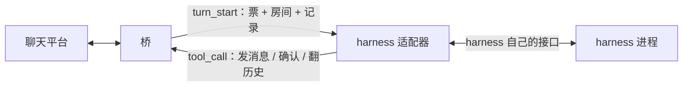

# 06 · harness 适配器

> 状态：opencode 那一份写完并测过协议层，还没在真的 opencode 上跑过（本机没装）。
> 原则：桥不懂 harness 的内脏，harness 也不懂平台细节。适配器是那个翻译。

## 一个适配器要干两件事

这两件事互不依赖，可以分别做到、分别缺席：

1. **工具面**：让模型看见桥上的九个工具（发消息、确认水位、翻历史、记笔记……），
   模型一调，就原样变成一帧 `tool_call` 发给桥。
2. **轮次驱动**：桥推来一轮（`turn_start`，带着这个房间的未读记录），把它变成 harness 里
   的一次对话，跑完回 `turn_end`。



只有工具面、没有轮次驱动的，叫**半接**：能发不能收，桥推过来的活没人干。这种事要在
文档里写清楚，不能让人以为接完了。

## 两半各有各的手段

| 能力 | 手段 | 需要 harness 有 | 代价 |
|------|------|-----------------|------|
| 工具面 | 插件里注册自定义工具 | 插件 / 扩展 API | 跟 harness 版本绑得紧 |
| 工具面 | 挂一个 MCP server | 支持 MCP（多数都有） | 多一层进程，桥要额外实现 MCP |
| 轮次驱动 | 进程内：插件里起后台循环，反调会话接口注入一条消息，等它回完 | 插件 API，且能反向驱动会话 | 可能和 harness 自己的事件派发打架 |
| 轮次驱动 | 进程外：桥旁边跑个小程序，用无头模式 / HTTP / CLI 驱动 | 无头模式或服务端 API | 慢；会话续接、结束判定都要自己猜 |

结论：**有插件 API 就走插件**，工具面和轮次驱动都在同一个进程里，最跟手；没有插件
API 才退到进程外驱动或 MCP。这条判断写进了 [ADR-0013](adr/0013-harness-adapter-shape.md)。

## 拿到一个新 harness，先问四句

1. 能不能注册自定义工具？（决定工具面走插件还是 MCP）
2. 能不能从扩展点里反过来驱动一次会话，并且知道它什么时候结束？（决定轮次驱动走进程内还是进程外）
3. 没有插件的话，有没有服务端 / 无头模式？能不能接着上一次的会话继续？
4. 上面都不行？那就只挂 MCP，算半接，文档里标明「只能发不能收」。

## 当前各家的情况

下面「判断」一栏里，只有 opencode 是我看过文档、写过代码的；其余是**待核实**，别当结论用。

| harness | 扩展点 | 轮次驱动 | 判断 |
|---------|--------|----------|------|
| opencode | 插件（`.opencode/plugins/`，可 `tool()` 注册、可拿 SDK client） | 进程内：`client.session.prompt` 返回即一轮结束 | 插件型，已实现，见 `harnesses/opencode/` |
| DSH | 插件 | 待核实 | 用户说可以走插件，具体接口未看 |
| WorkBuddy | 待核实 | 待核实 | 未看 |
| Trae | 待核实 | 待核实 | 未看 |
| Codex | 无插件；有 `codex exec` 这类无头入口 | 进程外：每轮起一次 | 大概率进程外 + MCP 补工具面 |
| OpenClaw | 待核实 | 待核实 | 未看 |

## opencode 这一份怎么用

两个文件必须挨着放（`qqab.mjs` import `qqab-wire.mjs`）：

```bash
cp harnesses/opencode/qqab.mjs harnesses/opencode/qqab-wire.mjs ~/.config/opencode/plugins/
```

配置全走环境变量——插件读不到桥的配置文件，那是桥自己的事：

| 变量 | 作用 |
|------|------|
| `QQAB_ENDPOINT` | 桥的接入点，默认 `127.0.0.1:7700` |
| `QQAB_TOKEN` | 设备令牌，必填；和 `config.toml` 里设备的 `token` 一致 |
| `QQAB_SESSION` | 钉死用哪个 opencode 会话；不填就按 `qqab:<设备>` 自动找 / 建 |

没给 `QQAB_TOKEN` 时插件直接不启用，只写一条警告——不阻塞 opencode 启动。

几个刻意的做法：

- **会话按设备一份**，标题 `qqab:<设备>`。启动时先找同名会话，有就接着用，没有才新建。
  会话就是设备的记忆（[ADR-0002](adr/0002-subscription-model.md)），重开 harness 不能失忆。
- **`prompt` 返回就是一轮结束**。不再去盯 `session.idle`——多一个状态源就多一处能对不上。
- **工具只在轮次内可用**。没有票的调用一律 `unauthorized`。这样人在 TUI 里手动跟同一个实例
  聊天，也不会把话发到别人的房间里。
- **失败也回 `turn_end`**。`prompt` 抛错、会话被删、连接断了，都带着错误收工——桥靠
  `turn_end` 或断连释放设备，不回就一直占着。
- **断线自己重连**，退避 1 秒起、最长 10 秒。桥比 opencode 晚启动也能接上。

## 怎么验

三层，越往下越真：

```bash
# 1. 协议层：假桥，验握手 / 开轮 / 工具配对 / 错误码 / 渲染
node --test harnesses/opencode/test/*.test.mjs

# 2. 对着真桥（不用 opencode）：握手成不成
node harnesses/opencode/probe.mjs --token <设备令牌>

# 3. 真链路：另开一个终端起桥，然后给人发一条 QQ 消息
cargo run -p qqab-bridge -- --config config.toml
```

第 3 步里 `probe.mjs` 会把投递的内容打出来、回一句话、确认水位。它和插件用的是同一个
协议客户端，所以这里看得到的，插件也看得到——区别只在「交给谁去思考」。

## 已知没验的地方

- 从插件内部调 `client.session.prompt`，会不会和 opencode 自己的事件派发互相等，没验过。
  兜底是轮次串行链 + 独立会话 + 失败即收工。真跑起来卡住，第一嫌疑是这里。
- 工具参数的 schema 用 `z.array(z.any())` 接内容段，靠描述文字教模型写元素。宁松勿严：
  写错了桥那边会给出比 zod 更准的话。
- `session.create` / `session.list` 的返回形状按文档写（`result.data.id`），两种形状都兼容了；
  opencode 换版本改形状时，这里要跟着看。
