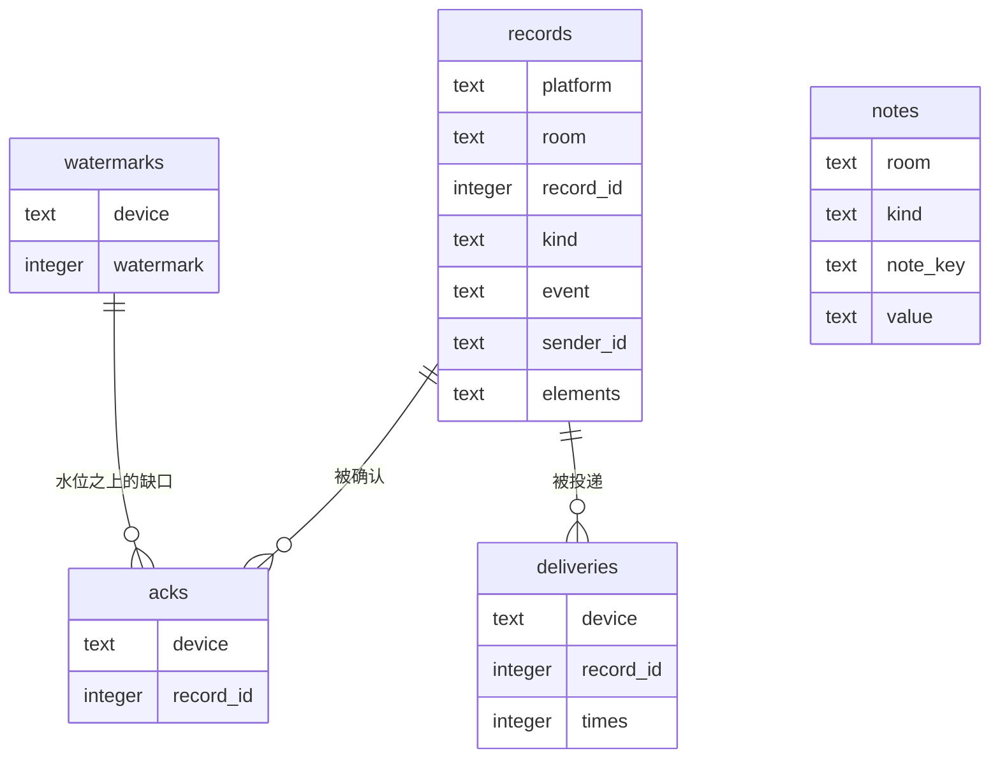

# 状态库

桥把「它亲眼见到的事」记在一个 SQLite 文件里。进程重启、机器断电，这份账都还在。

默认位置 `state/qqab.db`（相对启动时的工作目录）。想换地方就写配置：

```toml
[storage]
path = "/var/lib/qqab/bridge.db"
```

目录不存在会自动建。**库打不开就不启动**——宁可起不来，也别退回内存悄悄跑起来：那样它看着一切正常，直到你重启才发现什么都没留下。

## 记了什么

| 表 | 一句话 | 粒度 |
|---|---|---|
| `records` | 流水：房间里说过的每一句、发生的每个事件 | 按房间，编号 1、2、3… 各自排 |
| `watermarks` | 水位：这个设备读到第几条了 | 按「设备 + 房间」 |
| `acks` | 乱序确认：水位之上、已经确认但前面还有缺口的那几条 | 按「设备 + 房间 + 记录」 |
| `deliveries` | 投递次数：这条记录投给这个设备几次了（「第 N 次投递」的 N） | 按「设备 + 房间 + 记录」 |
| `notes` | 笔记：agent 自己记下的备忘 | 按房间 + 种类 + 键 |
| `meta` | 结构版本号 | 一个键值对 |



几件容易记错的事：

- **未读不单独存**。它是「流水里水位之后的部分」，每次现算。不存第二份账，就不会出现两套账对不上。
- **编号是房间内的**。QQ 群 123 和 Discord 频道 123 是两个房间，各自从 1 开始。
- **流水里只有原话**。`redelivery` / `note`（「第 2 次投递；调 ack_messages 确认 #5…」）不落库，投递时由 `deliveries` 现场算出来。

## 不记的东西

| 不记 | 为什么 |
|---|---|
| 票（`Ticket`） | 一次性的。重启后旧票全部作废，不会「接着跑半截轮次」 |
| 排队中的轮次 | 同上。重启后干净地等下一次唤醒 |
| 配置 | 留 TOML。人编辑的东西不该和运行数据混在一起，也才好 diff、回滚 |
| 聊天记忆（AI 怎么理解这些内容） | 归 harness。桥只管「房间里发生了什么」 |

## 怎么查

方式一，用 `sqlite3` 命令行（有就最省事）：

```bash
sqlite3 state/qqab.db "select record_id, sender_name, elements from records order by record_id desc limit 5;"
sqlite3 state/qqab.db "select * from watermarks;"
```

方式二，没有 `sqlite3` 就用 Python（自带）：

```bash
python3 - <<'EOF'
import sqlite3
con = sqlite3.connect("state/qqab.db")
for row in con.execute("select record_id, kind, sender_name, elements from records order by record_id desc limit 5"):
    print(row)
EOF
```

看某个房间有多少未读：

```bash
python3 - <<'EOF'
import sqlite3
con = sqlite3.connect("state/qqab.db")
room, device = "private/323622442", "main"
water = con.execute("select watermark from watermarks where device=? and platform='qq' and room=?", (device, room)).fetchone()
water = water[0] if water else 0
n = con.execute("select count(*) from records where platform='qq' and room=? and record_id>?", (room, water)).fetchone()[0]
print(f"{device} 在 {room} 的未读：{n} 条（水位 {water}）")
EOF
```

## 备份、恢复、清空

- **备份**：拷 `qqab.db` 一个文件就够。要热的（桥在跑）就连 `qqab.db-wal` 一起拷，或者先停桥。
- **恢复**：把文件放回原处再启动。
- **清空**：删掉 `qqab.db*`。等于失忆——编号从 1 重来、笔记全没、已读进度全没——但桥照样起得来。

## 结构版本

`meta.schema_version` 记着这个库是第几版结构。程序只认识自己那一版：

- 库比程序**新** → 拒绝打开，报「库是第 N 版，本程序只认识第 M 版」。这是故意的：老程序往新库里写，比起不来严重得多。
- 改表流程：先写迁移（把老数据搬到新结构），再加版本号，最后才改代码。

## 已知限制

- **流水不会自动清理**。群聊跑久了会一直长。以后要加按保留期/条数的清理，做成配置项。
- **单进程**。桥的所有访问都在同一把互斥锁后面，一条连接够用；两个桥同时开同一个库文件不在支持范围（那样「谁推水位」就没准了）。
- **WAL 的伴生文件**。`qqab.db-wal` / `qqab.db-shm` 是 SQLite 的正常工作文件，别单独删或单独拷，要拷就三个一起。
- **没做加密**。库文件是明文，敏感内容自己注意文件权限。
