# 状态库

桥把「它亲眼见到的事」记在一个 SQLite 文件里。进程重启、机器断电，这份账都还在。

默认位置 `state/acb.db`（相对启动时的工作目录）。想换地方就写配置：

```toml
[storage]
path = "/var/lib/acb/bridge.db"
```

目录不存在会自动建。**库打不开就不启动**——宁可起不来，也别退回内存悄悄跑起来：那样它看着一切正常，直到你重启才发现什么都没留下。

## 记了什么

| 表 | 一句话 | 粒度 |
|---|---|---|
| `records` | 流水：房间里说过的每一句、发生的每个事件 | 按房间，编号 1、2、3… 各自排 |
| `watermarks` | 水位：这个会话读到第几条了 | 按「会话 + 房间」 |
| `acks` | 乱序确认：水位之上、已经确认但前面还有缺口的那几条 | 按「会话 + 房间 + 记录」 |
| `deliveries` | 投递次数：这条记录投给这个会话几次了（「第 N 次投递」的 N） | 按「会话 + 房间 + 记录」 |
| `notes` | 笔记：agent 自己记下的备忘 | 按房间 + 种类 + 键 |
| `feedback` | 反馈：agent 写的「哪里卡住了」，同指纹合并、次数累加 | 按条，自带会话/房间/现场 |
| `meta` | 结构版本号 | 一个键值对 |

投递时 `unread` 会同时排除 `acks` 里的编号：乱序确认过的记录不会再投一遍（ADR-0010）。

```mermaid
erDiagram
    records {
        text connection
        text room_key
        text room_json
        integer record_id
        text kind
        text event
        text sender_id
        text elements
        integer at_self
        integer reply_to_self
        text platform_id
        text labels
        integer suppressed
    }
    watermarks {
        text session
        integer watermark
    }
    acks {
        text session
        integer record_id
    }
    deliveries {
        text session
        integer record_id
        integer times
    }
    notes {
        text room
        text kind
        text note_key
        text value
    }
    records ||--o{ acks : "被确认"
    records ||--o{ deliveries : "被投递"
    watermarks ||--o{ acks : "水位之上的缺口"
```



几件容易记错的事：

- **未读不单独存**。它是「流水里水位之后的部分」，每次现算。不存第二份账，就不会出现两套账对不上。
- **编号是房间内的**。`qq:group/123` 和 `qq2:group/123`（两个号看同一个群）是两个房间，各自从 1 开始。
- **流水里只有原话**。`redelivery` / `note`（「第 2 次投递；调 ack_messages 确认 #5…」）不落库，投递时由 `deliveries` 现场算出来。
- **`suppressed` 是记录属性，不是投递时机**。写进流水后，所有订阅者（包括之后才加的）都不会把它算作未读；确认相邻记录时水位会直接越过它，不会被这个「永远读不到」的洞卡住。

## 清理：旧流水什么时候可以删

流水只增不减，跑几个月就是一个一直变大的文件。所以要有一个上限：

```toml
[retention]
max_records_per_room = 5000   # 每个房间最多留多少条
max_age_days = 90             # 记录最多留多少天
```

两项写 0 就不作任何清理。桥每 5 分钟扫一次，真删了会打一行：

```
清理：qq:group/158296748 删掉 1200 条已读记录，留 5000 条
```

**只削读过的**，这是整个清理里唯一不能妥协的地方。判据有三条，同时成立才删：

| 判据 | 意思 |
|---|---|
| `record_id < 安全线` | 安全线 = 这个房间所有**在册**订阅者水位的最小值。有一个会话没读到，这个房间这次就一条都不删 |
| 不在最新 N 条里 | N = `max_records_per_room` |
| `at` 早于时间线 | 时间线 = 现在 − `max_age_days` 天 |

三条都是「宁可少删」的方向：任何一条不成立就不动。未读是投递的原料，删掉就是真丢了，没有第二次机会。

几条行为说明：

- **每个房间至少留一条**。不是留念，是编号基准：编号靠 `MAX(record_id)+1` 往推，全删光了下一个又回到 1，而水位还停在几百——新消息会被当成已读，直接消失（`MIN_KEPT`）。
- **没人订阅的房间不清**。「谁读过」这个判据只对在册订阅者成立，人删了订阅，这个房间的账就不归这里管了。
- **会话从配置里删掉之后，它的水位不再挡清理**。曾经读过的记录可以删；那个会话以后再加回来，中间那段它是看不到的。
- 清理**不影响编号**：删了 1..1200，下一句仍然是 5001。
- `get_history` 只能翻到清理剩下的部分。翻不到不代表没发生过，只代表太旧了。

## 不记的东西

| 不记 | 为什么 |
|---|---|
| 票（`Ticket`） | 一次性的。重启后旧票全部作废，不会「接着跑半截轮次」 |
| 排队中的轮次 | 同上。重启后干净地等下一次唤醒 |
| 配置 | 留 TOML。人编辑的东西不该和运行数据混在一起，也才好 diff、回滚 |
| 聊天记忆（AI 怎么理解这些内容） | 归 harness。桥只管「房间里发生了什么」 |

## 怎么查

方式一，用 `sqlite3` 命令行（有就最省事）：

```bash
sqlite3 state/acb.db "select record_id, sender_name, elements from records order by record_id desc limit 5;"
sqlite3 state/acb.db "select * from watermarks;"
```

方式二，没有 `sqlite3` 就用 Python（自带）：

```bash
python3 - <<'EOF'
import sqlite3
con = sqlite3.connect("state/acb.db")
for row in con.execute("select record_id, kind, sender_name, elements from records order by record_id desc limit 5"):
    print(row)
EOF
```

看某个房间有多少未读：

```bash
python3 - <<'EOF'
import sqlite3
con = sqlite3.connect("state/acb.db")
room, session = "private/323622442", "main"
water = con.execute("select watermark from watermarks where session=? and connection='qq' and room_key=?", (session, room)).fetchone()
water = water[0] if water else 0
n = con.execute("select count(*) from records where connection='qq' and room_key=? and record_id>?", (room, water)).fetchone()[0]
print(f"{session} 在 {room} 的未读：{n} 条（水位 {water}）")
EOF
```

## 备份、恢复、清空

- **备份**：拷 `acb.db` 一个文件就够。要热的（桥在跑）就连 `acb.db-wal` 一起拷，或者先停桥。
- **恢复**：把文件放回原处再启动。
- **清空**：删掉 `acb.db*`。等于失忆——编号从 1 重来、笔记全没、已读进度全没——但桥照样起得来。

## 结构版本

`meta.schema_version` 记着这个库是第几版结构：

- 库比程序**新** → 拒绝打开，报「库是第 N 版，本程序只认识第 M 版」。这是故意的：老程序往新库里写，比起不来严重得多。
- 库比程序**老** → 就地升级（补列、建索引，最后才改版本号），老数据照旧读得出来。
  补列是幂等的：中途失败，下次启动接着补。
- 改表流程：先把迁移写进 `SqliteStore::check_version`，再把 `SCHEMA_VERSION` 加一，最后才改读写代码。

已经发生过的迁移：

| 版本 | 改了什么 | 为什么 |
|---|---|---|
| 1 → 2 | `records` 加 `reply_to_self`、`platform_id` 与对应索引 | 判「别人引用的是不是我发的消息」，靠平台编号反查 |
| 2 → 3 | 五张表的 `platform` 列改名 `connection`、`room` 列改名 `room_key`；`records` 加 `room_json`；顺手删掉第 1 版留下的重复索引 `records_platform_id` | 房间从「平台 + 房间号」改成「连接 + 路径」。只改名不搬数据，老库照旧读得出来；`room_json` 是后路——以后房间要换成更自由的形状，原始结构还在 |
| 7 → 8 | `records` 加 `event_meta`（JSON：`tags` / `payload` / `summary`） | 平台事件不只存一个类型名；老事件记录该列为空，读出来按「无标签、无载荷、无摘要」处理 |
| 8 → 9 | `records` 加 `labels`（JSON 数组） | 适配器给记录追加通用标签（如撤回事件给原消息加 `recall`）；老记录默认空 |
| 9 → 10 | `records` 加 `suppressed`（0 / 1） | 记录自身声明「只进流水」；不投递、不唤醒、不计未读，之后新加的订阅者也生效 |

## 已知限制

- **清理是按房间整段削的**，不做「留最近 N 天但保留中间某条」这种事。需要留档的话，备份库文件比在桥里做例外规则更省事。
- **单进程**。桥的所有访问都在同一把互斥锁后面，一条连接够用；两个桥同时开同一个库文件不在支持范围（那样「谁推水位」就没准了）。
- **WAL 的伴生文件**。`acb.db-wal` / `acb.db-shm` 是 SQLite 的正常工作文件，别单独删或单独拷，要拷就三个一起。
- **没做加密**。库文件是明文，敏感内容自己注意文件权限。
