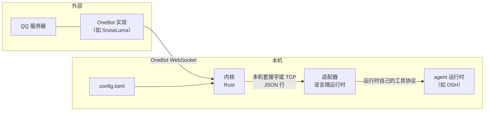
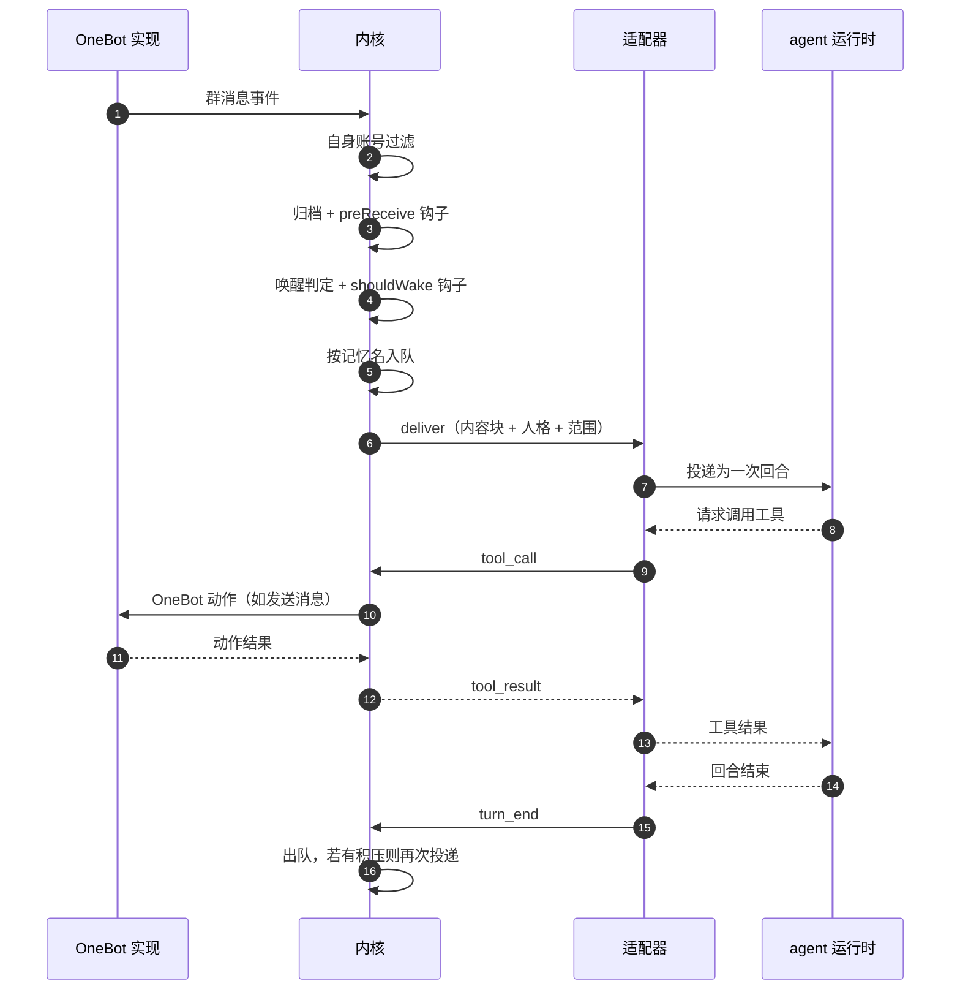

# 总览

## 一句话

内核负责「QQ 上发生了什么」，适配器负责「让模型说点什么」，两者之间只有一份本机 JSON 协议。

## 进程与边界

四个进程角色，四条链路：

1. **QQ 与 OneBot 实现之间**：由 OneBot 实现负责，qq-agent-bridge 不参与。
2. **OneBot 实现与内核之间**：WebSocket，标准 OneBot 11 事件与动作。
3. **内核与适配器之间**：本机套接字，或 TCP（跨机器），见 [协议](05-protocol.md)。
4. **适配器与 agent 运行时之间**：适配器是该运行时眼里的一个工具服务端。

内核与适配器的生命周期互相独立。内核可以比运行时活得久：运行时重启，内核不必重连 QQ；内核重启，适配器会重连。

## 边界判据

判断一段逻辑属于哪一层，只用一个问题：

> 这段代码里出现的标识符是**群号、账号、消息**，还是**会话、回合、工具调用**？

出现前者是内核，出现后者是适配器。两者都不出现的（比如日志、配置解析）放内核，因为内核是常驻进程。

由此可以推出三条：

- 内核不知道会话标识、请求标识、回合这些运行时概念的存在。
- 适配器不知道群号、QQ 号、消息段结构的存在。它收到的永远是**已经渲染好的内容块**。
- 任何需要同时知道两边的逻辑，都必须是**协议消息**，不能是共享代码。

## 一次消息的完整路径

## 为什么是两个进程

单进程也能做，旧实现就是单进程。拆开的理由是**两边的变更速度与信任级别不同**：

| | 内核 | 适配器 |
| --- | --- | --- |
| 依赖 | OneBot 协议 | 某个 agent 运行时的 SDK |
| 变更驱动 | QQ 侧行为、唤醒规则 | 运行时的 API 变动 |
| 崩溃影响 | QQ 掉线 | 单个回合失败 |
| 重启代价 | 重连全部账号 | 重连 socket |

更关键的是**适配器是可替换的**：换一个 agent 运行时，只重写适配器，内核不动。这条性质要求适配器不持有任何 QQ 知识，也要求内核不假设运行时的形态。

## 明确不做的事

- **不做消息中转服务**：qq-agent-bridge 是单个部署者自用的桥，不是多租户网关。
- **不替 OneBot 实现兜底**：登录、重连、协议兼容由 OneBot 实现负责。
- **不接管 agent 运行时的会话存储**：记忆的载体是运行时的会话，qq-agent-bridge 只记住「记忆名与会话的映射。
