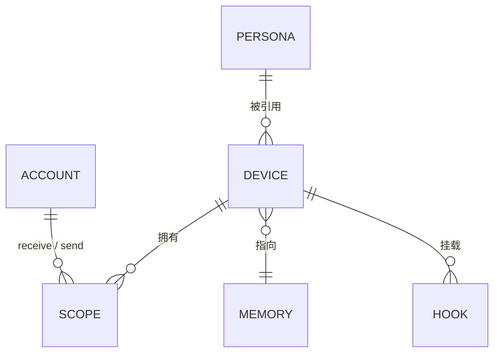

# 领域模型

## 五个概念



| 概念 | 是 | 不是 |
| --- | --- | --- |
| 账号 | 一条 OneBot 连接 + 一个 QQ 号 | 一个进程，一台机器 |
| 人格 | 一段文本 | 一份记忆，一个设备 |
| 设备 | 一份「自我」的配置 | 一个进程，一个会话 |
| 范围 | 设备对某个群的一对收发账号 | 一个群（群可以被多个设备看到） |
| 记忆 | 记忆名，指向运行时的会话 | 消息本身（消息在内核归档） |

## 关系约束

**账号是全局的。** 一个账号可以被多个设备使用。它的连接信息（地址、令牌）只在全局配置里写一次。

**人格是全局的。** 一个设备引用一个人格；多个人格可以指向同一份文本，但设备只认一个。人格不绑定账号——同一份人格可以被不同账号身份使用。

**设备是配置记录，不是进程。** 设备不拥有连接、不拥有线程。它是一组「当收到这些群的消息时，用这个人格、按这些规则处理」的声明。

**记忆是设备的属性，不是范围的属性。** 一个设备只有一个记忆名。两个设备填同一个记忆名，就共享同一份记忆——这是共享记忆的唯一机制，没有别的开关。

**范围属于设备。** 同一个群可以被多个设备各自声明一个范围，互不影响。

## 配置形态

```toml
[[accounts]]
id = "main"
self_id = "10001"
ws_url = "ws://127.0.0.1:6700"
token = "env:QQ_TOKEN"

[[accounts]]
id = "backup"
self_id = "10002"
ws_url = "ws://127.0.0.1:6701"

[[personas]]
id = "whale"
text = "你是……"          # 或 file = "personas/whale.md"

[[devices]]
id = "alice-phone"
persona = "whale"
memory = "alice"            # 记忆名，不是会话 ID
accounts = ["main", "backup"]

  [[devices.scopes]]
  group = "20001"
  receive = ["main"]
  send = ["main", "backup"]

  [devices.wake]
  any_message = true
  ignore_speakers = ["30002"]

[[devices]]
id = "alice-pc"
persona = "whale"
memory = "alice"            # 同一份记忆
accounts = ["main"]

  [[devices.scopes]]
  group = "20003"
  receive = ["main"]
  send = ["main"]
```

## 三条由模型推出的硬规则

**一、同一个 `(group, account)` 只能被一个设备声明。** 否则同一个账号收到的同一条消息会进两个设备的记忆，两边各自回复。这是启动期检查，冲突即失败，不降级。

注意约束的粒度是「群 + 账号」而不是「群」：`alice-phone` 用 `main` 收 `20001`，`alice-pc` 用 `backup` 收同一个群，是合法的——两个不同账号各自看到一份消息流。

**二、共享记忆的设备共享串行队列。** 队列的键是记忆名。两个设备指向 `alice`，它们投递的回合在 `alice` 这一条队列上串行，不会同时进入同一个会话。

**三、记忆名与范围的声明互不牵连。** 两个设备可以共享记忆但订阅完全不同的群；也可以订阅同一个群但用不同账号、不同人格、不同记忆。模型里没有任何一条要求它们一致。

## 为什么记忆名不是会话 ID

会话由 agent 运行时创建，ID 由运行时分配，且在会话被回收后重新创建时会变。配置里写不出一个稳定的会话 ID。

所以配置写的是**记忆名**——一个部署者起的、稳定的字符串。适配器维护 记忆名与会话 ID 的映射，首次投递时惰性创建，会话消失时重建并更新映射。内核只知道记忆名。

这条设计的直接后果：**队列键必须是记忆名，不能是会话 ID**。按会话 ID 做键，会话重建的那一刻会出现两条并行队列，把两条消息同时灌进一个新会话。

## 账号在范围里的两个角色

范围里的 `receive` 和 `send` 是两份独立的列表，因为它们是两件事：

- `receive`：从哪些账号的连接上收这个群的消息。**决定订阅关系。**
- `send`：回复时允许用哪些账号发。**决定发送侧的故障轮换。**

写成一个列表会让「主号掉线自动换备用号发」变成「连收也切到备用号」——而备用号可能根本不在这个群里。

## 工具调用时的身份

设备有多个账号时，工具需要知道用哪个号执行。默认取 `send` 列表的第一个可用账号；调用方可以显式指定 `as`。`send` 里没有可用账号时，工具返回错误而不是静默换群或换设备。
