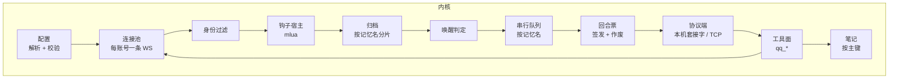
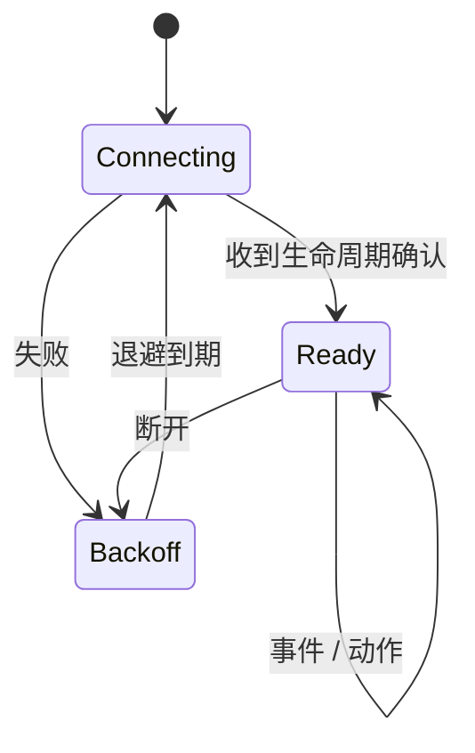

# 内核

内核是 Rust 进程，常驻，负责全部 QQ 侧语义。

## 职责边界

内核**做**：连接管理、消息归档、自身账号过滤、唤醒判定、钩子执行、队列、投递、工具实现、配置校验。

内核**不做**：渲染提示词、创建会话、决定模型行为、管理上下文窗口。这些是适配器和运行时的职责。

内核不知道运行时的存在。它只认识「记忆名」和「一个可以投递内容的通道」。

## 模块划分



| 模块 | 输入 | 输出 | 状态 |
| --- | --- | --- | --- |
| 配置 | `config.toml` | 已校验的模型 | 启动时一次性 |
| 连接池 | 账号列表 | 事件流 | 每账号一条长连接，独立重连 |
| 归档 | 事件 | 追加到记忆 | 有界，按记忆名分片 |
| 笔记 | 工具调用 | 覆盖写或查询 | 按记忆名分文件，有界 |
| 身份过滤 | 事件 + 设备账号集 | 保留 / 丢弃 / 标记 | 无 |
| 唤醒判定 | 归档增量 + 设备规则 | `Option<原因>` | 无 |
| 钩子宿主 | 脚本 + 事件 | 修改后的事件或判定 | 每设备一个 Lua 环境 |
| 串行队列 | 唤醒结果 | 投递请求 | 每记忆名一条队列 |
| 回合票 | 队列状态 | 票 / 作废 | 进行中的回合表 |
| 工具面 | 工具调用 | OneBot 动作 | 无 |

## 一次事件的处理顺序

顺序是设计的一部分，不可重排：

1. **连接池**收到 OneBot 事件，按 `self_id` 归到账号。
2. **身份过滤**：若 `user_id` 属于该设备声明的账号集合，标记为「自己」——写入归档，但不进未读，不触发唤醒。**这一步在钩子之前**，因为钩子不应有机会让一个号把自己另一个号当成群友。
3. **钩子 `preReceive`**：可以丢弃事件、改写文本、附加标签。返回丢弃则该事件到此为止。
4. **归档**：按事件涉及的设备写入对应记忆。多台设备订阅同一个群时，同一事件分别进入各自的记忆；同一设备轮换的多个账号看到它，只归档一份。取源是 `receive(G)` ∪ { `send(G)` 里账号自己发出的消息 }——纯发送号不在 `receive(G)` 里也得归档，否则同一句话在不在记忆里会取决于当时哪条连接在线。前提是 G 已属于这台设备的某个范围；这类消息是 `own`，按第 2 步不进未读、不触发唤醒。
5. **钩子 `postReceive`**：归档后、判定前。可以补充上下文或标记。
6. **唤醒判定**：先跑设备配置的规则得到结果，再交给钩子 `shouldWake`。钩子可以否决（返回 `nil`）、改写原因，也可以在规则未命中时自行判定为唤醒——返回的字符串即原因。配置规则是默认值，钩子是最终决定。
7. **入队**：唤醒命中且该记忆名的队列空闲，立即投递；否则只更新积压水位，等当前回合结束。
8. **投递**：把自上次投递以来的未读消息渲染成内容块，连同人格、范围信息发给适配器。

**判定针对增量，投递针对积压。** 判定只看刚到的这一条——否则重连重发、轮换交接的重复到达会被叫醒两次；投递出去的是自上次确认以来的全部未读。两者分开，是因为「要不要说话」由一条新消息决定，「说什么」必须覆盖整个积压段。

**积压期间的唤醒原因要留。** 队列只记「有没有积压」这个布尔值，合并投递时却仍需要一个原因标签。取积压期间**最强**的那个（`WakeReason::rank` 与判定链同序），不是最后一条的——否则一次 @ 之后紧跟着几条闲聊，标签就变成 `any_message`。

**拍一拍不是消息，但走同一条判定链。** 它没有正文、不进归档，却照样要过忽略名单、休眠期与 `poke` 开关；把它当一条正文为空的输入喂进链条，比在批量层另写一个分支更不容易与逐条判定分叉。

**水位在投递成功后才推进。** 投递失败（适配器不可达）不推进水位，重试因此拿到的是同一批——归档才是消息的真相，协议只承载当下这一刻。

## 队列语义

**键是记忆名。** 同一记忆名的队列严格串行：一个回合结束（适配器回报 `turn_end`）后才投递下一批。

**积压合并。** 队列忙时到达的消息不排队成多个回合，只累加水位。回合结束后若积压非空，合并成**一次**投递。这避免「群里刷屏后连续回复十条」。

**投递失败重试。** 适配器不可达时，投递退避重试，不丢消息——消息已在归档里，重试只是重新计算增量。

**不跨记忆名抢占。** `alice` 和 `bob` 两条队列完全独立，互不等待。一个人两个设备用不同记忆名，就是两个独立对话。

**票随回合签发，随回合作废。** 队列空闲时签一张票，票带着这一轮的身份（记忆名、设备、群、可用发送账号）。工具调用靠票确定自己是谁；回合结束票即失效。超时的回合由 `sweep` 作废，但积压水位保留——超时不代表消息丢了。

## 连接管理

每个账号一条 WebSocket，独立状态机：



一条连接断开不影响其它账号，也不清空归档。`send` 列表里有多个账号时，发送动作按顺序尝试可用账号。

**退避指数增长、封顶固定。** 连续失败从 1 秒起翻倍，封顶 5 分钟；成功一次即清零，所以稳定跑了很久的连接掉线后仍从 1 秒重连，而不是接着上次的长退避等下去。

**连接用什么模型。** 阻塞 `tungstenite`，每账号一个线程，不引入 async runtime——理由与代价见 [ADR-0006](../adr/0006-blocking-websocket-per-thread.md)。单线程同时照看 socket 与动作队列靠**读超时**：socket 每 200 ms 醒来一次，顺手看一眼有没有动作要发。这不是「事件驱动」，是「定时醒来看看」，是阻塞方案唯一多出来的复杂度。

**事件与动作响应共用一条流。** 等动作响应的这段时间里上游可能照样推事件——群里不会因为你正在发消息就安静。这些事件不能丢，所以读循环把它们带回来补投，而不是「读到不是响应的帧就跳过」。

**单帧解码失败不结束连接。** 上游发来一条认不出的 JSON 就丢掉它继续读；只有传输层的真错误（断开、握手失败）才让这条连接进入退避。上游实现的扩展字段随时在变，一条坏帧不该让一个账号掉线。

内核从事件里只取判定要用的那几项。一条群消息：

```json
{
  "post_type": "message",
  "message_type": "group",
  "self_id": 10001,
  "group_id": 20001,
  "message_id": "7451",
  "user_id": 30002,
  "sender": {"user_id": 30002, "nickname": "小明", "card": ""},
  "time": 1792561540,
  "message": [{"type": "text", "data": {"text": "在吗"}}]
}
```

**号码一律按字符串持有。** 上游把 `group_id`、`message_id`、`user_id` 序列化成 number 还是 string 并不一致，用数字接会在部分实现上丢精度；解码时统一拍成字符串再比。

**媒体只留占位符。** `image` 段写 `[图片]`、`file` 段写 `[文件]`——归档要的是已落地的路径，而落媒体不在这一层。消息不会因为「附件还没实现」而消失。

**`@` 自己只置标志、不进正文。** 投递渲染统一加 `@你 ` 前缀，正文里再写一遍就成了两遍。`@` 别人则留在正文里，模型需要知道这句是对谁说的。

## 归档

按记忆名分片，每片有界（默认按条数与字节数双限）。归档只保留「尚未被某个回合消费」的部分加上少量用于上下文的近期消息——它不是聊天记录数据库。

消息的稳定标识是 `(群, 消息 ID)`。账号不参与——一个群里轮换的多个接收账号看到的是同一条消息，按账号分开归档会让一次轮换交接在未读里留下两条副本。重复到达（上游重连后重发、交接期间两个账号各看到一次）不会变成两条，只合并视角：`own` 与 `at_self` 取或，任意一条连接认为「这是自己发的」，合并后就是。

**水位按群。** 一次投递只覆盖一个群（回合身份里 `group` 是单值），所以每个群各有自己的未读水位；推进 A 群的水位不影响 B 群的未读。水位只前进——回退等于把已消费的消息再投递一次。

| 上限 | 默认 | 语义 |
| --- | --- | --- |
| `max_messages` | 500 | 每片保留条数 |
| `max_bytes` | 4 MiB | 每片负载字节（UTF-8，不含结构体开销） |
| `context_messages` | 50 | 已消费的消息留多少条供上下文 |

**先保未读。** 超限时先丢已消费的上下文；未读本身超过硬上限时才丢最旧的，并把条数记进 `dropped`——投递据此说明「有更早的消息超出保留窗口」，而不是假装完整。

落盘形态，一个分片：

```json
{
  "shards": {
    "alice": {
      "watermarks": {"20001": 34},
      "dropped": 0,
      "messages": [
        {
          "seq": 33,
          "account": "main",
          "group": "20001",
          "message_id": "7451",
          "sender_id": "30002",
          "sender_name": "小明",
          "text": "在吗",
          "at_self": true,
          "at": 1792561540309
        },
        {
          "seq": 34,
          "account": "main",
          "group": "20001",
          "message_id": "7452",
          "sender_id": "10001",
          "text": "在",
          "own": true,
          "at": 1792561542875
        }
      ]
    }
  }
}
```

序号在分片内严格递增，文件顺序即序号顺序；读入时不满足即视为损坏，不重排。水位指向已被淘汰的序号是合法的（那条消息被上限丢过）。

**接收账号只用于轮换。** 一个群可以挂多个接收账号，但同一时刻只有一个在收；它收不到时（掉线、风控）切到下一个。切换窗口内两个账号可能都看到同一条消息，上面那条标识把它们合成一条。切换期间漏掉的消息靠重连补拉，归档层不负责——序号是分片内自增，与账号无关，所以轮换不会让水位错位。

## 持久化

内核有两类需要落盘的东西：归档和[笔记](08-notes.md)。

**存储格式尚未确定**，在 SQLite 与「按记忆名分目录的文件」之间。两者都能满足「按记忆名分片、有界、崩溃后可恢复」。

笔记层已经按「与存储无关」的方式实现：内存态是权威，磁盘只在启动时读一次、每次写入后整体写出；序列化与反序列化是独立的一层（`notes::NoteStore::to_json` / `from_json`）。所以选哪个格式不改变笔记的行为，只改变那两次 I/O 的实现。

这个选择影响的是归档：归档落到 SQLite，笔记就存成表；归档是文件，笔记就是 `<state>/notes/<记忆名>.json`。**笔记不单独引入存储引擎**——两者共用同一层，否则内核要维护两套持久化机制。

选择时需要考虑的只有一条：归档是写入频繁、读取按水位的追加型数据，笔记是低频、按主键覆盖的小数据。若一个格式对两者都合适，就选它；若不适合，宁可让笔记迁就归档。

## 钩子宿主

每设备一个独立的 Lua 环境，由 `mlua` 提供。环境里只有纯函数与只读数据：不加载 `io`、`os`、`package`，不提供 `require`。脚本来自配置，由部署者手写——**不是插件系统，不接受外部输入作为脚本**。

细节见 [钩子](06-hooks.md)。

## 工具面

工具声明在适配器侧，实现全部在内核。工具调用携带回合票，内核用它确定「这一轮是哪个设备、哪个范围、哪些账号」，从而执行正确的动作。

内核实现的工具只做 QQ 动作，不做判断：发消息、查历史、发表情、传文件、拍一拍、记笔记。权限与范围限制由内核在动作前检查，不由适配器检查——适配器不掌握范围信息。

## 崩溃与恢复

内核崩溃：全部连接断开，归档在磁盘上的部分保留，重启后重连并恢复水位。正在进行的回合由适配器感知 socket 断开并终止。

内核正常退出：通知适配器，等待进行中的回合结束（有超时），再关闭。
