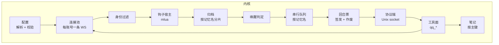
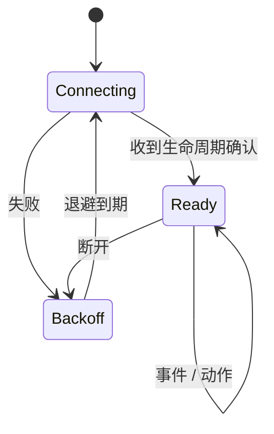

# 内核

内核是 Rust 进程，常驻，负责全部 QQ 侧语义。

## 职责边界

内核**做**：连接管理、消息归档、自身账号过滤、唤醒判定、钩子执行、队列、投递、工具实现、配置校验。

内核**不做**：渲染提示词、创建会话、决定模型行为、管理上下文窗口。这些是适配器和运行时的职责。

内核不知道运行时的存在。它只认识「记忆名」和「一个可以投递内容的通道」。

## 模块划分

| 模块 | 输入 | 输出 | 状态 |
| --- | --- | --- | --- |
| 配置 | `config.toml` | 已校验的模型 | 启动时一次性 |
| 连接池 | 账号列表 | 事件流 | 每账号一条长连接，独立重连 |
| 归档 | 事件 | 追加到记忆 | 有界，按记忆名分片 |
| 笔记 | 工具调用 | 覆盖写或查询 | 按记忆名分文件，有界 |
| 身份过滤 | 事件 + 设备账号集 | 保留 / 丢弃 / 标记 | 无 |
| 唤醒判定 | 归档增量 + 设备规则 | `Option<原因>` | 无 |
| 钩子宿主 | 脚本 + 事件 | 修改后的事件或判定 | 每设备一个 Lua 环境 |
| 串行队列 | 唤醒结果 | 投递请求 | 每记忆名一条队列 |
| 回合票 | 队列状态 | 票 / 作废 | 进行中的回合表 |
| 工具面 | 工具调用 | OneBot 动作 | 无 |

## 一次事件的处理顺序

顺序是设计的一部分，不可重排：

1. **连接池**收到 OneBot 事件，按 `self_id` 归到账号。
2. **身份过滤**：若 `user_id` 属于该设备声明的账号集合，标记为「自己」——写入归档，但不进未读，不触发唤醒。**这一步在钩子之前**，因为钩子不应有机会让一个号把自己另一个号当成群友。
3. **钩子 `preReceive`**：可以丢弃事件、改写文本、附加标签。返回丢弃则该事件到此为止。
4. **归档**：按事件涉及的设备写入对应记忆。一个事件可能同时进入多个设备的记忆（不同账号各自订阅了同一个群时）。
5. **钩子 `postReceive`**：归档后、判定前。可以补充上下文或标记。
6. **唤醒判定**：先跑设备配置的规则得到结果，再交给钩子 `shouldWake`。钩子可以否决（返回 `nil`）、改写原因，也可以在规则未命中时自行判定为唤醒——返回的字符串即原因。配置规则是默认值，钩子是最终决定。
7. **入队**：唤醒命中且该记忆名的队列空闲，立即投递；否则只更新积压水位，等当前回合结束。
8. **投递**：把自上次投递以来的未读消息渲染成内容块，连同人格、范围信息发给适配器。

## 队列语义

**键是记忆名。** 同一记忆名的队列严格串行：一个回合结束（适配器回报 `turn_end`）后才投递下一批。

**积压合并。** 队列忙时到达的消息不排队成多个回合，只累加水位。回合结束后若积压非空，合并成**一次**投递。这避免「群里刷屏后连续回复十条」。

**投递失败重试。** 适配器不可达时，投递退避重试，不丢消息——消息已在归档里，重试只是重新计算增量。

**不跨记忆名抢占。** `alice` 和 `bob` 两条队列完全独立，互不等待。一个人两个设备用不同记忆名，就是两个独立对话。

**票随回合签发，随回合作废。** 队列空闲时签一张票，票带着这一轮的身份（记忆名、设备、群、可用发送账号）。工具调用靠票确定自己是谁；回合结束票即失效。超时的回合由 `sweep` 作废，但积压水位保留——超时不代表消息丢了。

## 连接管理

每个账号一条 WebSocket，独立状态机：

一条连接断开不影响其它账号，也不清空归档。`send` 列表里有多个账号时，发送动作按顺序尝试可用账号。

## 归档

按记忆名分片，每片有界（默认按条数与字节数双限）。归档只保留「尚未被某个回合消费」的部分加上少量用于上下文的近期消息——它不是聊天记录数据库。

消息的稳定标识是 `(账号, 群, 消息 ID)`。不同账号看到同一条消息时，各自归档一份，因为各自的视角（比如自己发的消息在别人眼里不是自己发的）不同。

## 持久化

内核有两类需要落盘的东西：归档和[笔记](08-notes.md)。

**存储格式尚未确定**，在 SQLite 与「按记忆名分目录的文件」之间。两者都能满足「按记忆名分片、有界、崩溃后可恢复」。

笔记层已经按「与存储无关」的方式实现：内存态是权威，磁盘只在启动时读一次、每次写入后整体写出；序列化与反序列化是独立的一层（`notes::NoteStore::to_json` / `from_json`）。所以选哪个格式不改变笔记的行为，只改变那两次 I/O 的实现。

这个选择影响的是归档：归档落到 SQLite，笔记就存成表；归档是文件，笔记就是 `<state>/notes/<记忆名>.json`。**笔记不单独引入存储引擎**——两者共用同一层，否则内核要维护两套持久化机制。

选择时需要考虑的只有一条：归档是写入频繁、读取按水位的追加型数据，笔记是低频、按主键覆盖的小数据。若一个格式对两者都合适，就选它；若不适合，宁可让笔记迁就归档。

## 钩子宿主

每设备一个独立的 Lua 环境，由 `mlua` 提供。环境里只有纯函数与只读数据：不加载 `io`、`os`、`package`，不提供 `require`。脚本来自配置，由部署者手写——**不是插件系统，不接受外部输入作为脚本**。

细节见 [钩子](06-hooks.md)。

## 工具面

工具声明在适配器侧，实现全部在内核。工具调用携带回合票，内核用它确定「这一轮是哪个设备、哪个范围、哪些账号」，从而执行正确的动作。

内核实现的工具只做 QQ 动作，不做判断：发消息、查历史、发表情、传文件、拍一拍、记笔记。权限与范围限制由内核在动作前检查，不由适配器检查——适配器不掌握范围信息。

## 崩溃与恢复

内核崩溃：全部连接断开，归档在磁盘上的部分保留，重启后重连并恢复水位。正在进行的回合由适配器感知 socket 断开并终止。

内核正常退出：通知适配器，等待进行中的回合结束（有超时），再关闭。
