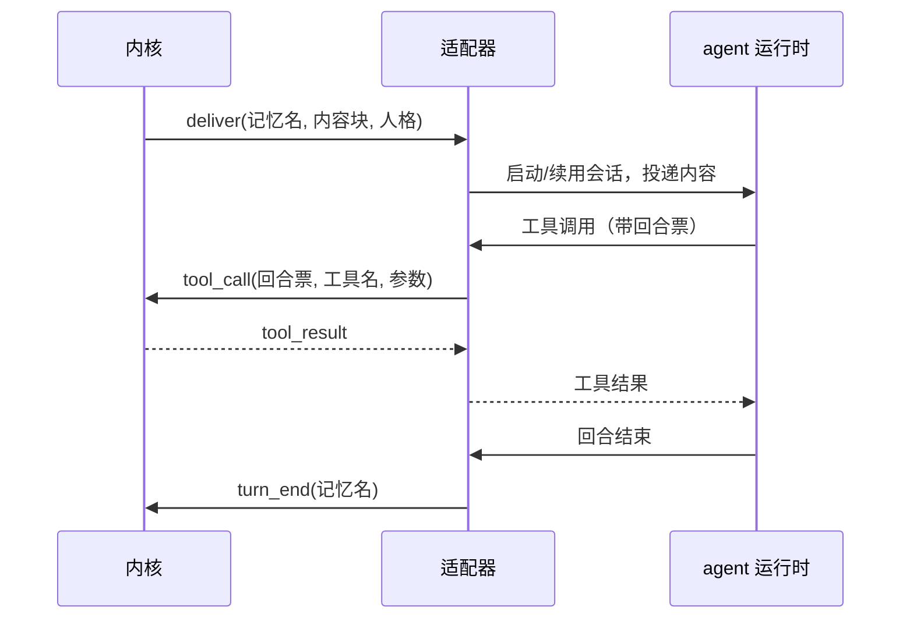
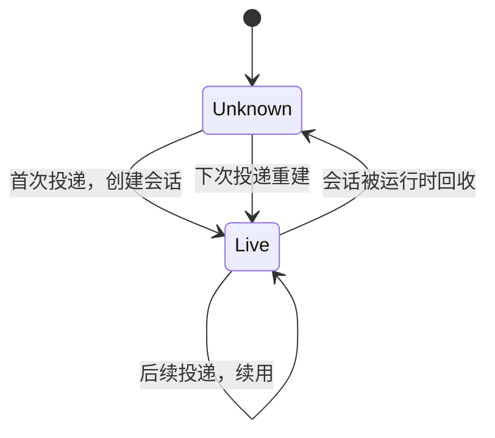

# 适配器

适配器是 TypeScript 进程，把内核的投递请求翻译成某个 agent 运行时的会话操作。

## 职责边界

适配器**做**：维护「记忆名与会话的映射、把内容块投递为一次回合、跟踪回合状态、向运行时暴露工具声明、把工具调用转回内核、上报回合结束。

适配器**不做**：判断该不该回复、决定用哪个账号发、渲染 QQ 消息段、过滤自己的消息。这些都在内核。

适配器里不出现群号、QQ 号、消息段结构。它收到的内容块已经是渲染好的文本与附件。

## 形态

**独立进程，通过本机 socket 与内核通信。** 不是运行时的进程内插件。

这个选择决定了两件事：

1. **中立性**：适配器只依赖运行时的公开接口（MCP），换运行时只重写这一层。进程内插件形态会依赖特定运行时的内部 API，换运行时就得重写，且把内核绑在了那个运行时上。
2. **身份来源受限**：作为外部进程，适配器拿不到「现在是谁在调我」这种结构化信息。所以工具调用必须携带凭证——见下面的回合票。

## 与运行时的接触面

适配器在运行时眼里是一个 MCP 工具服务端。接触面只有两个方向：

适配器不解析工具参数的含义，只做转发与错误映射。参数语义属于内核。

## 记忆名到会话的映射

映射持久化在适配器自己的状态目录里，键是记忆名。它记录的是运行时分配的会话标识，不是内核的任何东西。

**会话标识会变。** 运行时回收会话后重建，新会话有新标识。适配器负责在重建时更新映射。这也是内核的队列键必须用记忆名而非会话标识的原因——会话标识不稳定，记忆名稳定。

## 回合与回合票

一个回合开始于一次 `deliver`，结束于运行时的回合结束事件。适配器为每个进行中的回合持有内核签发的回合票。

回合票的作用是让工具调用能被归因：内核收到 `tool_call` 时，靠票确定这是哪个设备、哪个范围、哪些可用账号。

**票在回合结束时作废。** 过期票、未知票、跨回合复用一律拒绝。这条不可配置。

## 工具声明的位置

工具名、描述、参数 schema 写在适配器（MCP SDK 在 TypeScript 生态里），工具实现全在内核。

这不违反分层，因为**声明不是策略**：声明只描述「可以调用什么、参数长什么样」，不包含任何 QQ 语义判断。真正的权限检查、范围限制、账号选择都在内核动作前完成。

## 并发

适配器可以同时持有多个记忆名的会话。但同一个记忆名同时只有一个回合——这个串行性由内核的队列保证，适配器不重复实现。

若内核投递时该记忆名已有进行中的回合（正常情况下不会发生），适配器拒绝并上报错误，而不是并发投递。

## 运行时不可用

运行时未启动或崩溃时，适配器不丢弃内核的投递：它向上报 `deliver_failed`，内核把该批次留在归档里，退避后重试。重试由内核驱动，适配器不自行重试——否则两侧的退避会叠加。

## 崩溃与恢复

适配器崩溃：内核感知 socket 断开，当前回合视为失败，投递退避重试；适配器重启后从状态目录恢复记忆名映射。

适配器重启不会导致 QQ 重连，因为连接归内核管。这是拆进程最直接的收益。
