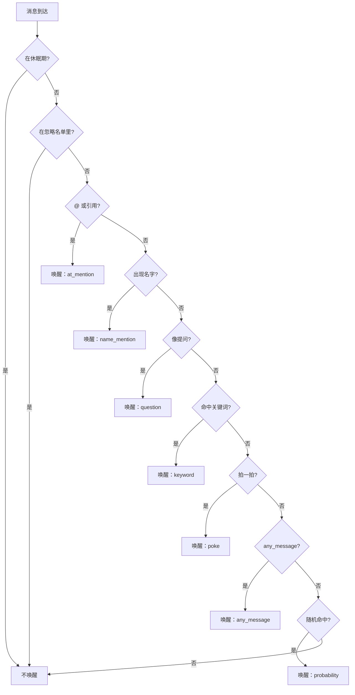

# 唤醒规则

唤醒决定「这条消息值不值得让模型看一眼」。判定在内核，不消耗模型 token。

## 配置形态

```toml
[devices.wake]
at_mention = true          # 被 @ 或被引用
name_mention = true        # 文本里出现设备名/昵称
question = false           # 文本以问号结尾或含疑问词
keywords = ["小鲸鱼", "上线"]  # 命中任一即唤醒
poke = true                # 有人拍一拍
probability = 0.05         # 普通消息的随机唤醒概率
any_message = false        # 任何消息都唤醒
ignore_speakers = []       # 在 any_message 生效时排除这些人
sleep_until = ""           # 在此之前不唤醒
```

全部字段可省略。省略时只响应 `at_mention` 与 `name_mention`。

## 判定顺序

判定是**正向条件的析取**，从上到下第一个命中的胜出：



**忽略名单在整条链的最前面**，所以它对所有条件生效——包括 `any_message`。这就是「除某人外都唤醒」：

```toml
[devices.wake]
any_message = true
ignore_speakers = ["30002"]
```

## 忽略名单的粒度

`ignore_speakers` 是 QQ 号列表。它排除的是**发言者**，不是消息内容。

若需要更复杂的条件——按时间段、按消息内容、按发言频率——写 `shouldWake` 钩子。见 [钩子脚本](04-hooks.md)。

## 主动冒泡

内核可以在群安静一段时间后主动唤醒设备。配置：

```toml
[devices.wake]
idle_prompt_after_min = 45    # 群安静这么久后允许主动冒泡；0 表示关闭
```

这是「允许」而不是「定时触发」：内核只在下一次有消息到达、或队列空闲且该群确实安静了这么久时给出一次机会。它不会凭空定时叫醒设备。

## 休眠

```toml
[devices.wake]
sleep_until = "2026-10-22T08:00:00+08:00"
```

休眠期内任何条件都不唤醒。到期后自动恢复。用于夜间静默。

## 发送账号的选择

唤醒后由模型决定说什么，但用哪个号发是内核的事：

1. 默认取该范围 `send` 列表的第一个可用账号。
2. 工具调用可以显式指定 `as`，取值是账号 `id`。
3. `send` 全部不可用时，工具返回错误，不静默换群或换设备。

`as` 的典型用途：一个设备持有两个号，想让不同的号在不同话题下发言。

## 调试

内核日志里每条消息都有一行判定结果：

```
[alice-phone] 群 20001 消息 40001 来自 30003 唤醒：at_mention
[alice-phone] 群 20001 消息 -40002 来自 30001 不唤醒：在忽略名单
```

判定结果不消耗 token，可以放心开日志观察。
